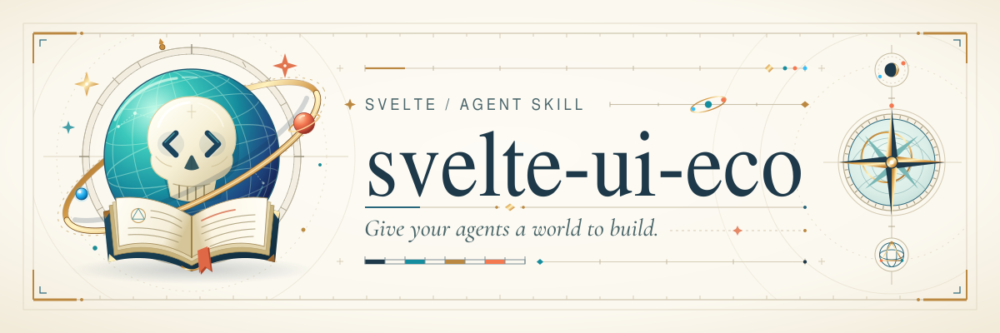

# svelte-ui-eco

An unofficial [Agent Skill](https://agentskills.io) for accessible Svelte 5 interfaces. It covers native HTML, Bits UI, and optional Skeleton UI, Tailwind CSS, and Lucide.

Use native HTML where it fits. Keep compatible components already in use. Prefer Bits UI for new custom interactions; use Skeleton's styled Svelte components when they fit the design system or cover features Bits UI lacks. Neither library depends on the other. This project ships guidance and runnable examples, not a component library or application template.

## Install the skill

Run from the project where you want to use the skill:

```sh
bunx --bun skills@latest add PhilosophiMoonbeam/svelte-ui-eco --skill svelte-ui-eco
```

Follow the [skills CLI](https://github.com/vercel-labs/skills) prompts to select your coding agents. Refresh skill discovery if your agent requires it. Installation does not add application dependencies.

> Use svelte-ui-eco to build accessible account preferences. Keep the existing visual style, use native controls where they fit, and use Bits UI for the confirmation dialog. Verify form submission and keyboard focus.

## Compatibility

Standalone modern Svelte 5 is supported. SvelteKit 3.1+ applies only to Kit-specific guidance; Kit 3.4.0 is the exact reference version, not the minimum. Retain a compatible existing toolchain and inspect the application's resolved versions before adapting examples.

| Package or tool | Reference version | Role |
| --- | --- | --- |
| Bun | 1.4.5 | Repository tooling and installation examples |
| Svelte | 5.59.1 | Framework |
| Bits UI | 2.22.0 | Default headless library for new custom widgets |
| `@internationalized/date` | 3.12.4 | Date and time examples only |
| `@sveltejs/kit` | 3.4.0 | Kit-specific guidance only |
| `@skeletonlabs/skeleton` | 5.0.6 | Optional CSS and themes |
| `@skeletonlabs/skeleton-svelte` | 5.0.6 | Optional styled Svelte components |
| `tailwindcss` | 4.3.5 | Optional CSS utilities |
| `@lucide/svelte` | 1.77.0 | Optional icons |

## Find the right guidance

Start with the [skill entrypoint](skills/svelte-ui-eco/SKILL.md) and follow its task router. Open [setup](skills/svelte-ui-eco/references/setup.md) for dependency and integration decisions, and [migration](skills/svelte-ui-eco/references/migration.md) when replacing old wrappers.

The [Bits UI catalog](skills/svelte-ui-eco/references/components.md) routes native alternatives and Bits primitives. The [Skeleton UI guide](skills/svelte-ui-eco/references/skeleton.md) covers retaining existing widgets, optional setup, and capabilities such as Toast, Carousel, and FileUpload. The [recipes](skills/svelte-ui-eco/references/recipes.md) and [example mounting guide](skills/svelte-ui-eco/examples/README.md) link standalone examples that do not require Skeleton, Tailwind, or Lucide.

Use the [Skeleton recipes](skills/svelte-ui-eco/references/skeleton-recipes.md) and [version-specific upgrade guide](skills/svelte-ui-eco/references/skeleton-migration.md) when maintaining a Skeleton app. The examples index includes a responsive shell and a native form. Historical runtime observations are kept separately from current API guidance.

Check installed declarations before applying a rolling documentation example. See [sources](skills/svelte-ui-eco/references/sources.md) for upstream links and evidence limits.

## Contribute

From the repository root, use Bun 1.4.5:

```sh
bun install --frozen-lockfile
bun run check
bun run check:examples
skills-ref validate skills/svelte-ui-eco
```

Use the Agent Skills [`skills-ref`](https://github.com/agentskills/agentskills/tree/main/skills-ref) validator for package structure. Repository checks do not replace browser verification: exercise the affected keyboard, focus, layout, and form behavior and report only what you observed.
