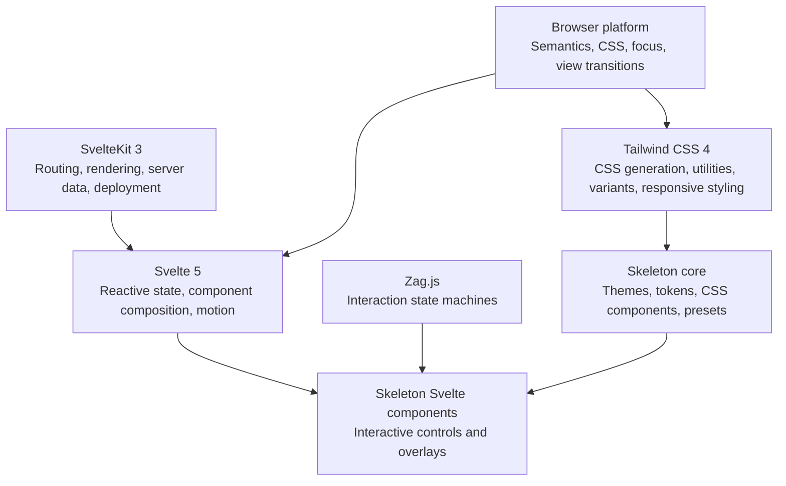

# Expressive UI Development Reference
## Skeleton 5, SvelteKit 3, Svelte 5, and Tailwind CSS 4

**Research cutoff: October 18, 2026**

**Recommended baseline:** Skeleton **5.0.1**, SvelteKit **3.1.0**, Svelte **5.57.2**, and Tailwind CSS **4.3.3**, with exact dependency versions recorded in the project lockfile.

The strongest design approach is **expressive branding around a calm operational interface**: vibrant accents, intentional typography, layered surfaces, and brief, meaningful feedback. Use animation to explain state and continuity, not to delay work or compete with it.

This document separates documented platform capabilities, design recommendations, and implementation limitations. Code examples are documentation-grounded patterns, not a starter application that has been compiled or browser-tested.

---

## 1. Verified versions and architectural baseline

### 1.1 Release snapshot

| Technology | Latest stable release verified | Release evidence | Development significance |
|---|---:|---|---|
| Skeleton core | **5.0.1** | Current documentation and package changelog | Updated theme format, brand tokens, variable element sizing, and expanded CSS components |
| Skeleton Svelte components | **5.0.1** | Current documentation and package metadata | Svelte components built on Skeleton’s design system and Zag.js interaction architecture |
| SvelteKit | **3.1.0** | GitHub release, October 14, 2026 | Kit 3 configuration, dependency, routing, and state changes apply |
| Svelte | **5.57.2** | GitHub release, October 6, 2026 | Runes, current motion APIs, snippets, and attachments |
| Tailwind CSS | **4.3.3** | GitHub release, July 16, 2026 | CSS-first configuration, modern color utilities, gradients, container queries, and v4.3 additions |

Sources: [Skeleton changelog](https://github.com/skeletonlabs/skeleton/blob/main/packages/skeleton/CHANGELOG.md), [Skeleton introduction](https://www.skeleton.dev/docs/svelte/get-started/introduction), [SvelteKit 3.1.0](https://github.com/sveltejs/kit/releases/tag/@sveltejs%2Fkit@3.1.0), [Svelte 5.57.2](https://github.com/sveltejs/svelte/releases/tag/svelte@5.57.2), [Tailwind 4.3.3](https://github.com/tailwindlabs/tailwindcss/releases/tag/v4.3.3).

**Version caveat:** search indexes and npm page snapshots can lag package releases. Skeleton’s current documentation and changelog identify 5.0.1, but an exact npm publication timestamp was not independently established. For project initialization, confirm registry metadata directly:

```bash
npm view @skeletonlabs/skeleton version peerDependencies
npm view @skeletonlabs/skeleton-svelte version peerDependencies
npm view @sveltejs/kit version engines peerDependencies
npm view svelte version
npm view tailwindcss version
```

These commands are verification instructions, not commands executed during this research.

### 1.2 Compatibility requirements

Skeleton’s installation page lists minimum supported major versions of SvelteKit 2, Svelte 5, and Tailwind 4. Its v5 Svelte component requirement is more specific: **Svelte `^5.40.0`**.

For the recommended **SvelteKit 3** baseline, Kit’s requirements are stricter:

| Dependency | SvelteKit 3 minimum |
|---|---:|
| Node.js | **22.17** |
| TypeScript | **6** |
| Svelte | **5.57.1** |
| Vite | **8.0.12** |
| `@sveltejs/vite-plugin-svelte` | **7** |

Use the strictest requirement across the application, framework, plugins, and deployment adapter. Do not interpret Skeleton’s “SvelteKit 2” minimum as evidence that a Kit 2 configuration remains valid under Kit 3.

Sources: [Skeleton installation](https://www.skeleton.dev/docs/svelte/get-started/installation/sveltekit), [Skeleton v5 migration](https://www.skeleton.dev/docs/svelte/get-started/migrate-from-v4), [SvelteKit 3 migration](https://svelte.dev/docs/kit/migrating-to-sveltekit-3).

### 1.3 Responsibility boundaries



Keep these responsibilities distinct:

- **SvelteKit** owns application structure and data/navigation lifecycles.
- **Svelte** owns reactive behavior and component-level rendering.
- **Skeleton core** supplies the design-system vocabulary.
- **Skeleton Svelte components** supply composed interactive interfaces.
- **Tailwind** supplies styling infrastructure and utility generation.
- **Browser APIs** supply native behavior and optional visual enhancements.

Skeleton is not a routing framework, Tailwind is not an interaction library, and animation does not replace application state management.

---

## 2. Architectural changes that affect implementation

### 2.1 Skeleton v5

Skeleton’s core package is framework-agnostic. Svelte-specific components come from a separate package:

```ts
import { Switch } from '@skeletonlabs/skeleton-svelte';
```

The current component architecture uses composed parts and Zag.js-backed interaction behavior. Expect APIs such as `Root`, `Control`, `Label`, and callbacks that report state changes.

Notable v5 changes include:

- Renamed and expanded typography tokens.
- Separate light/dark brand colors and contrast colors.
- Variable sizing for buttons and form fields.
- Native-dialog and disclosure styling.
- Masks and corner-shape utilities.
- Updated field-group markup.
- Removal of the old `card-hover` utility.
- Updated preset themes.

**Migration rule:** do not mix archived v2/v3 examples with v5 installation, token names, or component APIs. Old global modal/toast-store recipes are not a reliable starting point for the current composed components.

For v4 applications, Skeleton recommends beginning from **4.15.2**, then using its migration tooling and reviewing the remaining manual changes. Custom themes require particular attention.

Sources: [Skeleton fundamentals](https://www.skeleton.dev/docs/svelte/get-started/fundamentals), [v4-to-v5 migration](https://www.skeleton.dev/docs/svelte/get-started/migrate-from-v4).

### 2.2 SvelteKit 3

SvelteKit 3 was announced on **October 1, 2026**. It preserves the framework’s routing and rendering model, but removes legacy features and changes several integration details.

Important changes:

| Area | Kit 3 behavior | Consequence |
|---|---|---|
| Configuration | Moves from `svelte.config.js` into the SvelteKit Vite plugin | Older setup instructions need adaptation |
| Library imports | `$lib` becomes `#lib` using standard subpath imports | Update application imports |
| Application state | `$app/stores` is removed | Use `$app/state` and Svelte 5 reactivity |
| URL state | `page.url` is readonly | Copy the URL before modifying it |
| Shallow routing | Prefer `goto(..., { shallow: true })` | Update modal/history recipes |
| Navigation hooks | Shallow routing also triggers hooks | Filter shallow events when appropriate |
| Refreshing data | `invalidateAll` is deprecated in favor of `refreshAll` | Review data refresh code |
| Navigation options | `keepFocus` and `noScroll` become `reset: false`; `replaceState` becomes `replace` | Do not copy old option names |
| Link attributes | Use `"false"` rather than `"off"` | Update `data-sveltekit-*` attributes |

Remote functions are not required for this UI stack. The Kit 3 announcement still describes Async Svelte as requiring an experimental flag. Treat that capability as a separate adoption decision rather than silently enabling it in a visual starter.

Sources: [SvelteKit 3 announcement](https://svelte.dev/blog/sveltekit-3-is-here), [migration guide](https://svelte.dev/docs/kit/migrating-to-sveltekit-3).

### 2.3 Tailwind CSS 4

Tailwind 4 changes configuration and styling infrastructure:

- **CSS-first configuration** through `@theme`.
- **Custom utilities** through `@utility`.
- **Custom variants** through `@custom-variant`.
- Automatic source detection, with explicit `@source` controls.
- Theme values available as CSS custom properties.
- Modern color handling, including OKLCH.
- Linear, radial, and conic gradient utilities.
- Container queries and richer state variants.
- A dedicated Vite integration.

Tailwind **4.3** adds first-party scrollbar utilities, size-container utilities, `zoom-*`, `tab-*`, and additional CSS variant capabilities. These are useful refinements, not a reason to alter standard browser behavior unnecessarily. For example, do not hide scrollbars merely to make a panel look cleaner.

Sources: [Tailwind directives](https://tailwindcss.com/docs/functions-and-directives), [Tailwind 4.3 release article](https://tailwindcss.com/blog/tailwindcss-v4-3).

---

## 3. Integration reference

### 3.1 Start from the current SvelteKit scaffold

```bash
npx sv create expressive-ui
cd expressive-ui

# If Tailwind was not selected during project creation:
npx sv add tailwindcss

npm install -D \
  @skeletonlabs/skeleton@5.0.1 \
  @skeletonlabs/skeleton-svelte@5.0.1
```

Verify the generated project uses the intended Kit 3 dependency baseline. Keep the scaffold’s adapter unless deployment requirements call for a different one.

### 3.2 Kit 3 Vite configuration

A minimal configuration shape is:

```ts
// vite.config.ts
import adapter from '@sveltejs/adapter-auto';
import { sveltekit } from '@sveltejs/kit/vite';
import tailwindcss from '@tailwindcss/vite';
import { defineConfig } from 'vite';

export default defineConfig({
  plugins: [
    tailwindcss(),
    sveltekit({
      adapter: adapter()
    })
  ]
});
```

In Kit 3, former `config.kit.*` options become top-level SvelteKit plugin options. Do not retain a second, conflicting Kit 2 configuration.

Sources: [Kit 3 migration](https://svelte.dev/docs/kit/migrating-to-sveltekit-3), [Tailwind SvelteKit guide](https://tailwindcss.com/docs/installation/framework-guides/sveltekit).

### 3.3 Global stylesheet

```css
/* src/routes/layout.css */
@import 'tailwindcss';

@import '@skeletonlabs/skeleton';
@import '@skeletonlabs/skeleton-svelte';
@import '@skeletonlabs/skeleton/themes/cerberus';
```

Load that stylesheet once:

```svelte
<!-- src/routes/+layout.svelte -->
<script lang="ts">
  import './layout.css';

  let { children } = $props();
</script>

{@render children()}
```

Activate the imported theme in `src/app.html`:

```html
<html lang="en" data-theme="cerberus">
```

Only import themes that the application actually offers. Additional theme imports increase CSS output.

**Forms requirement:** Skeleton’s documented form utility classes depend on the official Tailwind forms plugin:

```bash
npm install -D @tailwindcss/forms
```

```css
/* Add after the stylesheet imports. */
@plugin '@tailwindcss/forms';
```

Sources: [Skeleton SvelteKit installation](https://www.skeleton.dev/docs/svelte/get-started/installation/sveltekit), [Forms and Inputs](https://www.skeleton.dev/docs/svelte/tailwind-components/forms).

---

## 4. Skeleton’s theming and token architecture

### 4.1 Three styling layers

A useful project model is:

1. **Theme tokens:** palette, typography, spacing, radius, root backgrounds, and brand colors.
2. **Semantic application styles:** page surfaces, primary actions, selected items, warnings, and promotional areas.
3. **Component states:** hover, focus, pressed, selected, loading, success, error, and disabled.

Do not make every component independently decide what “primary” or “elevated” means. Centralize those decisions so changes remain coherent.

### 4.2 Palette structure

Skeleton provides seven named palettes:

- `primary`
- `secondary`
- `tertiary`
- `success`
- `warning`
- `error`
- `surface`

Each has eleven shades:

```text
50 100 200 300 400 500 600 700 800 900 950
```

Each shade also has a corresponding contrast token.

```html
<div class="bg-primary-500 text-primary-contrast-500">
  A themed filled surface
</div>
```

**`brand` is not an eighth eleven-shade palette.** In v5, it is a separately configurable light/dark accent and contrast pair.

Relevant tokens include:

```css
--color-brand-light
--color-brand-contrast-light
--color-brand-dark
--color-brand-contrast-dark
```

Sources: [Skeleton colors](https://www.skeleton.dev/docs/svelte/design/colors), [Core API](https://www.skeleton.dev/docs/svelte/get-started/core-api).

### 4.3 Theme customization

Customize an imported theme under its selector:

```css
[data-theme='cerberus'] {
  --radius-base: 0.75rem;
  --radius-container: 1.5rem;

  --typo-base--font-family: system-ui, sans-serif;
  --typo-heading--font-weight: 800;

  --color-brand-light: var(--color-secondary-600);
  --color-brand-contrast-light: var(--color-secondary-contrast-600);

  --color-brand-dark: var(--color-secondary-400);
  --color-brand-contrast-dark: var(--color-secondary-contrast-400);
}
```

These are v5 names. For example:

| Older token | v5 token |
|---|---|
| `--base-font-family` | `--typo-base--font-family` |
| `--heading-font-weight` | `--typo-heading--font-weight` |
| `--body-background-color` | `--color-root-bg-light` |
| `--body-background-color-dark` | `--color-root-bg-dark` |

For substantial palette changes, generate or author a complete theme. Changing one shade without reviewing its contrast token and neighboring shades can produce inconsistent results.

Source: [Skeleton migration token reference](https://www.skeleton.dev/docs/svelte/get-started/migrate-from-v4).

### 4.4 Surface pairings

Skeleton condenses light/dark color selection into paired classes:

```html
<main class="bg-surface-50-950 text-surface-950-50">
  <section class="card bg-surface-100-900 p-6">
    ...
  </section>
</main>
```

The ordering is:

```text
{property}-{palette}-{light-mode-shade}-{dark-mode-shade}
```

For example:

```css
.text-primary-300-700 {
  color: light-dark(
    var(--color-primary-300),
    var(--color-primary-700)
  );
}
```

An initial surface hierarchy might be:

| Role | Starting point |
|---|---|
| Application canvas | `bg-surface-50-950` |
| Content panel | `bg-surface-100-900` |
| Stronger inset region | `bg-surface-200-800` |
| Primary text | `text-surface-950-50` |

These are starting points, not automatic contrast guarantees. A dark theme may also need borders and adjusted shadows to distinguish elevations clearly.

### 4.5 Theme selection and color mode are different

- **Theme:** which design-token set is active.
- **Mode:** whether light or dark values are selected.

Changing `data-theme` does not inherently mean “switch to dark mode.”

For explicit class-controlled mode, synchronize Tailwind’s variant with CSS `color-scheme`:

```css
@custom-variant dark (&:where(.dark, .dark *));

:root {
  color-scheme: light;
}

:root.dark {
  color-scheme: dark;
}
```

The distinction matters:

- `dark:` responds to the configured selector.
- Skeleton’s paired colors use `light-dark()`, which responds to the computed `color-scheme`.

Persist the user’s preference and apply it before the first meaningful paint where practical. A server-readable preference can help avoid a light/dark flash and hydration disagreement.

Sources: [Skeleton mode guide](https://www.skeleton.dev/docs/svelte/guides/mode), [MDN `light-dark()`](https://developer.mozilla.org/en-US/docs/Web/CSS/Reference/Values/color_value/light-dark).

### 4.6 Presets

Skeleton’s built-in preset families are:

| Family | Typical use |
|---|---|
| `preset-filled` | Strong emphasis |
| `preset-tonal` | Lower-emphasis colored surfaces |
| `preset-outlined` | Secondary actions or boundaries |

Examples:

```html
<button type="button" class="btn preset-filled-brand">
  Create project
</button>

<button type="button" class="btn preset-tonal-primary">
  Preview
</button>

<button type="button" class="btn preset-outlined">
  Cancel
</button>
```

Filled and outlined presets also support documented shade forms, such as `preset-filled-primary-500`.

**Important:** glass, ghost, elevated, and gradient treatments shown as customization examples are not all additional built-in preset families. Define application-specific utilities explicitly instead of inventing Skeleton class names.

Source: [Skeleton presets](https://www.skeleton.dev/docs/svelte/tailwind-utilities/presets).

---

## 5. Tailwind 4 techniques for expressive styling

### 5.1 CSS-first tokens

Use `@theme` for values that should generate Tailwind utilities:

```css
@theme {
  --font-display: system-ui, sans-serif;
  --ease-expressive: cubic-bezier(0.2, 0.8, 0.2, 1);
  --color-campaign: oklch(0.72 0.19 325);
}
```

This enables utilities such as `font-display`, `ease-expressive`, and `bg-campaign`.

Use ordinary custom properties for values that do not need generated utilities. Avoid maintaining duplicate palette definitions in both Skeleton theme CSS and an unrelated application token system.

### 5.2 Modern color spaces

OKLCH separates:

- **L:** perceptual lightness.
- **C:** chroma.
- **H:** hue.

This makes palette adjustments more predictable than directly manipulating RGB channels. However:

- Equal OKLCH lightness is not a WCAG contrast guarantee.
- Very high chroma can exceed a display’s gamut.
- White text on a vivid color can still fail contrast.
- Gradient interpolation can create intermediate colors that were not individually approved.

Test the rendered result, not just token values.

### 5.3 Gradients

Tailwind 4 supports:

```html
<div class="bg-linear-to-br from-primary-500 to-secondary-500"></div>

<div class="bg-radial from-secondary-300 to-primary-900"></div>

<div class="bg-conic from-primary-500 via-tertiary-500 to-primary-500"></div>
```

Use gradients for:

- Hero artwork.
- Decorative frames.
- Campaign panels.
- Selected-state accents.
- Limited progress or completion visuals.

Avoid placing essential body text directly on a variable gradient unless contrast is verified across the entire text region. A solid text panel or controlled scrim is usually more robust.

A gradient is not “dynamic” merely because it is a gradient utility. Runtime effects require changes to classes, custom properties, or animated layers.

Source: [Tailwind background-image utilities](https://tailwindcss.com/docs/background-image).

### 5.4 Reusable custom utilities

```css
@utility expressive-frame {
  padding: 1px;
  border-radius: var(--radius-container);
  background-image: linear-gradient(
    135deg,
    var(--color-primary-500),
    var(--color-secondary-500),
    var(--color-tertiary-500)
  );
}
```

```html
<div class="expressive-frame">
  <section class="card bg-surface-50-950 p-6">
    Content stays on a stable surface.
  </section>
</div>
```

This separates an expressive outer layer from a readable inner layer.

### 5.5 Source detection and runtime values

Tailwind scans source text. It cannot reliably infer constructed class names:

```ts
// Avoid:
const className = `bg-${palette}-500`;
```

Use complete class strings:

```ts
const treatments = {
  primary: 'bg-primary-500 text-primary-contrast-500',
  secondary: 'bg-secondary-500 text-secondary-contrast-500'
};
```

For continuous runtime values, use CSS custom properties or inline styles rather than generating unbounded utility names.

Use `@source` for external packages or monorepo directories that are not detected automatically. Do not copy an old Skeleton `@source` recipe into a v5 project without checking whether the current package stylesheet already supplies the required integration.

Sources: [Tailwind source detection](https://tailwindcss.com/docs/detecting-classes-in-source-files), [custom styles](https://tailwindcss.com/docs/adding-custom-styles).

---

## 6. Skeleton component, primitive, and utility catalog

The current documentation exposes the following framework-component catalog. Grouping below is editorial; it does not imply separate package boundaries.

### 6.1 Svelte framework components

| Group | Components | Useful applications |
|---|---|---|
| Structure and navigation | **App Bar, Navigation, Tabs, Accordion, Collapsible, Pagination, Steps, Tree View** | Application hierarchy, progressive disclosure, staged workflows |
| Selection and input | **Combobox, Date Picker, File Upload, Listbox, Rating Group, Segmented Control, Slider, Switch, Tags Input, Toggle Group** | Searchable selection, expressive controls, immediate input feedback |
| Overlays and floating interfaces | **Dialog, Floating Panel, Menu, Popover, Portal, Tooltip** | Focused tasks, contextual actions, supplementary information |
| Identity and visual presentation | **Avatar, Carousel, Marquee, QR Code** | Identity, galleries, promotional presentation, sharing |
| Progress and feedback | **Progress — Circular, Progress — Linear, Toast** | Loading, task progress, non-blocking results |
| Localization support | **Locale Provider** | Locale-aware component behavior |

This is **32 documented component entries**, counting the two progress variants separately. Components and stability labels can change independently of the main package version.

Source: [Skeleton’s current Svelte reference](https://www.skeleton.dev/llms-svelte.txt).

### 6.2 Core CSS component groups

| Group | Purpose |
|---|---|
| Badges | Compact labels and counts |
| Buttons | Native button styling and sizes |
| Cards | Content grouping |
| Chips | Compact tags or related controls |
| Dialogs | Native `<dialog>` styling |
| Disclosures | Native `<details>` and `<summary>` styling |
| Dividers | Visual separation |
| Forms and Inputs | Form controls, field groups, and meter styling |
| Placeholders | Loading or provisional content |
| Tables | Tabular presentation |

These are CSS styling facilities, not necessarily Svelte component imports.

Two distinctions matter:

- **Dialog component** and **native dialog styling** are different implementation paths.
- **Accordion/Collapsible components** and **native disclosures** solve related problems with different behavior and complexity.

### 6.3 Utilities and expressive features

| Facility | Use | Limitation |
|---|---|---|
| Presets | Consistent emphasis treatments | Custom styling still requires contrast checks |
| Masks | Decorative image or element silhouettes | Do not clip focus indicators or essential content |
| Corner Shapes | Distinctive container geometry | Limited browser support; use progressive enhancement |
| Color pairings | Mode-aware surfaces and text | Depend on correct color-scheme behavior |
| Typography tokens | Consistent expressive type | Preserve readable body text and zoom behavior |
| Element sizing | Consistent button/field dimensions | Visual size alone does not prove target-size compliance |

Masks and corner-shape features are marked beta in the current reference. **Marquee is also marked beta**, with explicit pause-control APIs.

### 6.4 High-value component choices

- **Switch, Segmented Control, Slider:** useful for immediate visual feedback, but labels and state must remain clear without motion.
- **Steps and Progress:** useful for truthful progress. Do not invent percentages for work that cannot be measured.
- **Toast:** useful for secondary confirmation. Do not make it the only place an important error or required action exists.
- **Dialog:** appropriate for a focused task or decision. Avoid interrupting users with modal celebrations.
- **Popover:** appropriate for contextual controls, not as a hidden container for essential instructions.
- **Floating Panel:** useful for expert tools, but needs non-drag alternatives and small-screen behavior.
- **Carousel and Marquee:** potentially expressive, but easy to misuse. Prefer user-controlled movement and avoid placing essential information only in rotating content.

Sources: [Marquee](https://www.skeleton.dev/docs/svelte/framework-components/marquee), [Floating Panel](https://www.skeleton.dev/docs/svelte/framework-components/floating-panel), [Forms and Inputs](https://www.skeleton.dev/docs/svelte/tailwind-components/forms).

---

## 7. 2026 design trends and “dopamine-driven” interfaces

### 7.1 What the evidence supports

2026 editorial trend reports emphasize:

- Coordinated saturated color systems.
- Tactile textures and layered depth.
- Oversized, expressive typography.
- More distinctive visual identities.
- Motion and interaction as part of brand expression.

Webflow’s 2026 report discusses coordinated color systems and expressive text treatments. Adobe’s report emphasizes saturated palettes and sensory textures.

These are **editorial trend observations**, not controlled evidence that these treatments improve usability, retention, or conversion.

Sources: [Webflow’s 2026 trends](https://webflow.com/blog/web-design-trends-2026), [Adobe’s 2026 design trends](https://www.adobe.com/express/learn/blog/design-trends-2026).

### 7.2 A useful interpretation of “dopamine-driven”

“Dopamine-driven UI” is not a precise engineering or usability standard. It should not be used to claim that a palette or animation causes a particular neurochemical response.

A practical, defensible interpretation is:

> Make actions feel responsive, progress understandable, and meaningful accomplishments satisfying.

Translate that into:

| Principle | Good implementation | Failure mode |
|---|---|---|
| Anticipation | Clear next action and expected result | Fake suspense or delayed completion |
| Immediate feedback | Pressed state and working state | A click appears to do nothing |
| Progress | Honest steps or measurable completion | Artificial percentages |
| Reward | Brief acknowledgment of a real accomplishment | Constant confetti for routine actions |
| Agency | Undo, dismiss, pause, and preference controls | Forced motion or repeated prompts |
| Hierarchy | One dominant next action | Every element is saturated and animated |

Useful reward loops are predictable and connected to the user’s goal:

```text
User chooses a task
→ interface responds
→ system performs the work
→ result is confirmed
→ user can continue, undo, or stop
```

Avoid optimizing for compulsive repetition, time spent, or notification response at the expense of the user’s objective.

### 7.3 Operational clarity

A visually engaging product still needs quiet areas.

A strong default:

- **Marketing surfaces:** broader expressive range.
- **Onboarding:** clear progress and selective celebration.
- **Core workflows:** stable layout and restrained motion.
- **High-density data:** low visual noise and strong grouping.
- **Errors and destructive actions:** direct language and unambiguous controls.

This is an attention-allocation strategy, not a fixed color-percentage formula.

NN/g’s guidance supports purposeful microinteractions and relative visual hierarchy rather than animation or saturation everywhere.

Sources: [Microinteractions](https://www.nngroup.com/articles/microinteractions/), [Animation purpose](https://www.nngroup.com/articles/animation-purpose-ux/), [Visual hierarchy](https://www.nngroup.com/articles/visual-hierarchy-ux-definition/).

---

## 8. Svelte reactivity and motion integration

### 8.1 Use application state as the source of truth

In Svelte 5:

- `$state` holds reactive state.
- `$derived` computes values from state.
- `$effect` synchronizes with external systems when necessary.
- `$props` defines component inputs.

Prefer derived values to effects that copy one state value into another.

```svelte
<script lang="ts">
  let completed = $state(2);
  let total = $state(5);

  let percent = $derived(
    total > 0 ? Math.round((completed / total) * 100) : 0
  );
</script>
```

Keep motion separate from business state:

- **Business state:** the upload is 60% complete.
- **Presentation state:** the bar eases toward 60%.
- **Accessible state:** assistive technology receives the actual progress.

Never let a decorative animation decide whether an operation succeeded.

References: [Svelte `$state`](https://svelte.dev/docs/svelte/$state), [`$derived`](https://svelte.dev/docs/svelte/$derived), [`$effect`](https://svelte.dev/docs/svelte/$effect).

### 8.2 Choose the smallest motion mechanism

| Need | Mechanism |
|---|---|
| Hover, focus, pressed styling | CSS and Tailwind variants |
| Entering/leaving content | `svelte/transition` |
| Reordering a keyed list | `animate:flip` from `svelte/animate` |
| Physically responsive values | `Spring` from `svelte/motion` |
| Fixed-duration interpolation | `Tween` from `svelte/motion` |
| Shared visual continuity between routes | View Transitions API through Kit navigation |
| Pointer or DOM integration | Svelte attachments, with cleanup |
| Complex artistic scenes | Dedicated rendering tool only when justified |

Avoid multiple systems animating the same property on the same element. For example, put a spring transform on a wrapper if the Skeleton control already uses transforms internally.

### 8.3 Current motion APIs

Use the current class APIs:

```ts
import { Spring, Tween, prefersReducedMotion } from 'svelte/motion';
```

- Change `.target` to request movement.
- Read `.current` for the animated value.
- Read `prefersReducedMotion.current`, not the object itself as a boolean.
- The older `spring` and `tweened` APIs are deprecated in the current reference.

Example of an optional spring-enhanced selection:

```svelte
<script lang="ts">
  import { Spring, prefersReducedMotion } from 'svelte/motion';

  let selected = $state(false);
  const scale = new Spring(1, {
    stiffness: 0.2,
    damping: 0.7
  });

  function toggle() {
    selected = !selected;

    void scale.set(selected ? 1.03 : 1, {
      instant: prefersReducedMotion.current
    });
  }
</script>

<div
  style:transform={`scale(${
    prefersReducedMotion.current ? 1 : scale.current
  })`}
>
  <button
    type="button"
    class="btn preset-tonal-primary"
    aria-pressed={selected}
    onclick={toggle}
  >
    {selected ? 'Selected' : 'Select'}
  </button>
</div>
```

Selection remains understandable through text and `aria-pressed` when motion is absent.

Source: [Svelte motion](https://svelte.dev/docs/svelte/svelte-motion).

### 8.4 Skeleton controlled state

A documented Switch pattern is:

```svelte
<script lang="ts">
  import { Switch } from '@skeletonlabs/skeleton-svelte';

  let checked = $state(false);
</script>

<Switch.Root
  {checked}
  onCheckedChange={(details) => {
    checked = details.checked;
  }}
>
  <Switch.Control>
    <Switch.Thumb />
  </Switch.Control>

  <Switch.Label>Enable visual effects</Switch.Label>
  <Switch.HiddenInput />
</Switch.Root>
```

Keep the hidden input and labeling structure unless the documented API specifies an equivalent. Decorative customization must not remove the semantics that make the control work.

Source: [Skeleton Switch](https://www.skeleton.dev/docs/svelte/framework-components/switch).

### 8.5 Entry, exit, and list motion

For short content transitions:

```svelte
<script lang="ts">
  import { fly } from 'svelte/transition';
  import { prefersReducedMotion } from 'svelte/motion';

  let expanded = $state(false);
</script>

<button
  type="button"
  class="btn preset-outlined"
  aria-expanded={expanded}
  aria-controls="details"
  onclick={() => {
    expanded = !expanded;
  }}
>
  Details
</button>

{#if expanded}
  <section
    id="details"
    transition:fly={{
      y: prefersReducedMotion.current ? 0 : 8,
      duration: prefersReducedMotion.current ? 0 : 160
    }}
  >
    Additional information.
  </section>
{/if}
```

For production disclosure behavior, prefer Skeleton’s appropriate component or native `<details>` when it meets the requirement. The example illustrates motion, not a reason to reimplement every control.

For keyed-list reordering, `animate:flip` can preserve spatial continuity. Provide non-drag controls if reordering is available through dragging.

### 8.6 Route view transitions

SvelteKit does not require a separate animation router. Its documented pattern uses `onNavigate` with `document.startViewTransition`.

Place this in a persistent layout:

```svelte
<script lang="ts">
  import { onNavigate } from '$app/navigation';
  import { prefersReducedMotion } from 'svelte/motion';
  import './layout.css';

  let { children } = $props();

  onNavigate((navigation) => {
    if (
      navigation.shallow ||
      prefersReducedMotion.current ||
      !document.startViewTransition
    ) {
      return;
    }

    return new Promise<void>((resolve) => {
      document.startViewTransition(async () => {
        resolve();
        await navigation.complete;
      });
    });
  });
</script>

{@render children()}
```

Important details:

- The returned promise releases navigation when the transition’s update callback starts.
- Awaiting `navigation.complete` lets the browser capture the new page state.
- Kit 3 shallow navigations also trigger hooks, hence the explicit filter.
- Unsupported browsers navigate normally.
- A transition is not a substitute for route titles, focus management, or announcements.
- Shared `view-transition-name` values must not collide among simultaneously rendered elements.
- Test interrupted and rapid navigations, not only the happy path.

Global CSS can keep the default effect brief:

```css
::view-transition-old(root),
::view-transition-new(root) {
  animation-duration: 160ms;
}

@media (prefers-reduced-motion: reduce) {
  ::view-transition-old(root),
  ::view-transition-new(root) {
    animation: none;
  }
}
```

Sources: [Kit view-transition FAQ](https://svelte.dev/docs/kit/faq), [Kit navigation](https://svelte.dev/docs/kit/$app-navigation), [MDN View Transitions](https://developer.mozilla.org/en-US/docs/Web/API/View_Transition_API).

---

## 9. Practical design patterns

### 9.1 Tactile primary action

Use shape, border, shadow, and a small pressed-state change. Do not rely only on movement.

```html
<button
  type="button"
  class="
    btn preset-filled-brand min-h-11
    shadow-sm
    focus-visible:outline-2
    focus-visible:outline-offset-4
    motion-safe:transition-transform
    motion-safe:duration-150
    motion-safe:hover:-translate-y-0.5
    motion-safe:active:translate-y-0
  "
>
  Create project
</button>
```

The focus indicator’s actual color and contrast must be checked against surrounding surfaces.

### 9.2 Expressive hero, stable content

Use a static gradient or illustration behind a solid reading surface:

- Decorative region: gradient, texture, or masked artwork.
- Content region: controlled surface color.
- Headline: distinctive display treatment.
- Body: restrained type size and line length.
- Primary action: one dominant treatment.

This gives expressive range without making the entire page difficult to scan.

### 9.3 Honest asynchronous feedback

Model the interaction explicitly:

```text
Idle → Pending → Success
               → Error → Retry
```

Implementation requirements:

- Show pending feedback immediately.
- Prevent unintended duplicate requests.
- Preserve entered data.
- Confirm success only after actual confirmation, unless an explicit optimistic model supports rollback.
- Keep errors near the relevant control.
- Expose status programmatically.
- Do not add a fake delay just to display an animation.

A useful live region remains mounted:

```html
<p role="status" aria-live="polite" aria-atomic="true">
  <!-- Update this text when status changes. -->
</p>
```

### 9.4 Earned completion

For meaningful completion:

- Show a clear textual result.
- Optionally add a brief checkmark or decorative flourish.
- Do not move focus to decorative content.
- Keep the result visible after the animation ends.
- Offer the next step without forcing it.
- Allow effects to be disabled.

Do not celebrate irreversible deletion, payment failure, or other sensitive events with playful motion that weakens clarity.

### 9.5 Layered cards and panels

Use a small surface vocabulary:

- Canvas.
- Standard card.
- Inset region.
- Overlay.

Distinguish them with a controlled combination of fill, border, and elevation. Avoid adding blur, glass, glow, and strong shadow to every layer.

For interactive cards, use a real link or button with a valid interaction structure. Avoid a clickable `<div>`, and avoid nesting secondary buttons inside an enclosing link.

### 9.6 Artistic effects as progressive enhancement

| Effect | Robust approach |
|---|---|
| Pointer spotlight | Decorative layer, `pointer-events: none`, disabled on coarse pointers and reduced motion |
| Animated gradient | Move or crossfade bounded layers; retain a static fallback |
| Card tilt | Small range, optional, no essential information revealed only by tilt |
| Masked artwork | Keep text and controls outside the mask |
| Shared-element route transition | Unique names, normal-navigation fallback |
| Confetti | Brief, bounded, non-interactive, excluded from the accessibility tree |
| Marquee | Visible pause control and a static reduced-motion alternative |

Do not assume animating a gradient, blur, or CSS variable is compositor-only. Profile the actual rendering cost.

---

## 10. Accessibility requirements

Skeleton’s accessible primitives reduce implementation work, but application composition can still introduce failures.

The following is a focused checklist, not a complete WCAG audit.

| Requirement | Standard | Implementation rule |
|---|---|---|
| Text contrast | WCAG 1.4.3, AA | At least **4.5:1** for ordinary text; **3:1** for qualifying large text |
| Non-text contrast | 1.4.11, AA | Required control/state information generally needs **3:1** against adjacent colors |
| Color independence | 1.4.1, A | Do not communicate status or selection through color alone |
| Keyboard access | 2.1.1, A | All functionality must be operable by keyboard |
| Visible focus | 2.4.7, AA | Preserve a clear focus indicator |
| Focus not obscured | 2.4.11, AA | Author-created content must not entirely hide the focused component |
| Target size | 2.5.8, AA | **24 × 24 CSS px**, subject to the criterion’s exceptions |
| Drag alternatives | 2.5.7, AA | Provide a single-pointer, non-drag alternative unless an exception applies |
| Status messages | 4.1.3, AA | Expose results without requiring focus movement |
| Autostarting motion | 2.2.2, A | Qualifying movement lasting over five seconds needs pause, stop, or hide |
| Flashing | 2.3.1, A | Avoid more than three flashes per second unless below defined thresholds |
| Reflow | 1.4.10, AA | Support narrow layouts without unnecessary two-dimensional scrolling |

**Do not confuse AA with AAA:**

- The enhanced **44 × 44 CSS px** target criterion is AAA, though it is a useful product default.
- Interaction-triggered animation disabling is specifically **2.3.3, AAA**.
- Focus Appearance’s stronger geometry/contrast requirements are **2.4.13, AAA**.

Honor reduced motion even when targeting AA. It is a practical safeguard for expressive interfaces.

Additional checks:

- Test contrast on every relevant gradient region and visual state.
- Do not treat contrast-token names as proof of compliance after customization.
- Disabled controls have contrast exceptions, but still need to be understandable.
- Provide labels, not only placeholders.
- Do not put essential information only in tooltips.
- For modal dialogs, test focus entry, trapping, Escape behavior, background interaction, and focus restoration.
- Avoid simultaneous toast and inline announcements that duplicate the same message.
- Test forced-colors mode, zoom, touch, and screen readers.

Sources: [WCAG 2.2](https://www.w3.org/TR/WCAG22/), [WCAG understanding documents](https://www.w3.org/WAI/WCAG22/Understanding/), [SvelteKit accessibility](https://svelte.dev/docs/kit/accessibility).

---

## 11. Performance and browser support

### 11.1 Browser requirements are cumulative

Tailwind 4’s documented baseline is:

- Safari **16.4+**
- Chrome **111+**
- Firefox **128+**

That is **not automatically the minimum browser matrix for the complete Skeleton 5 application**.

Skeleton’s paired colors use `light-dark()`, a newer capability than some of Tailwind’s minimum versions. Corner shapes and advanced view-transition features have their own support constraints.

Therefore:

1. Establish the application’s browser matrix.
2. Check every essential CSS feature against it.
3. Provide fallback styling for required functionality.
4. Make decorative features optional.
5. Test actual target browsers.

Sources: [Tailwind upgrade guide](https://tailwindcss.com/docs/upgrade-guide), [MDN `light-dark()`](https://developer.mozilla.org/en-US/docs/Web/CSS/Reference/Values/color_value/light-dark).

### 11.2 Performance targets

Use Core Web Vitals at the **75th percentile**, assessed separately for mobile and desktop:

| Metric | Good threshold |
|---|---:|
| Largest Contentful Paint | **≤ 2.5 seconds** |
| Interaction to Next Paint | **≤ 200 milliseconds** |
| Cumulative Layout Shift | **≤ 0.1** |

These are experience metrics, not animation-duration limits.

Practical rules:

- Render meaningful content through SSR where appropriate.
- Do not lazy-load the LCP image.
- Reserve image, video, and provisional-content dimensions.
- Keep pointer handlers and click handlers short.
- Avoid reactive application-state updates on every pointer event when a local visual update is sufficient.
- Prefer transform and opacity for simple motion, but measure layer and paint costs.
- Use `will-change` selectively, not on every card.
- Avoid large continuously animated blur or backdrop-filter regions.
- Load heavy artistic effects only where used.
- Pause offscreen or hidden-tab animation.
- Do not disable SSR globally to accommodate a decorative effect.
- Clean up observers, event listeners, animation frames, and third-party instances.

Source: [web.dev Core Web Vitals](https://web.dev/articles/vitals).

---

## 12. Recommended implementation policy

### Design system

- Maintain one authoritative theme and token layer.
- Define semantic roles for actions, surfaces, selection, status, and promotion.
- Use saturated colors selectively.
- Keep success, warning, and error roles consistent.
- Separate campaign expression from operational UI.

### Interaction

- Prefer CSS for local state styling.
- Use Svelte transitions for entry/exit.
- Use `Spring` or `Tween` only where interpolation adds value.
- Preserve Skeleton’s composed semantics.
- Never make an animation a prerequisite for completing work.

### Motion

Suggested initial values, to validate with users:

| Motion type | Starting range |
|---|---:|
| Press/hover feedback | **80–160 ms** |
| Small content reveal | **120–220 ms** |
| Panel or route transition | **160–300 ms** |
| Completion flourish | Brief and non-blocking |

These are design recommendations, not standards or universal optimums. Spring duration also depends on its physical parameters.

### Verification

Before accepting a pattern:

- Test keyboard and touch operation.
- Test reduced motion.
- Test light and dark modes.
- Test all offered themes.
- Test loading, empty, error, disabled, and success states.
- Test slow responses and repeated input.
- Test overlays with sticky navigation.
- Test rapid route changes and browser Back.
- Check production CSS generation.
- Run type checking and production builds.
- Add visual-regression tests for core surfaces and controls.
- Use field performance data after launch.

For usability evaluation, measure **task completion, errors, recovery, comprehension, and perceived control**. Do not use engagement time alone as proof that the design is better.

---

## 13. Maintenance guidance for future development

This reference is a dated snapshot, not a permanent version guarantee.

For each upgrade:

1. Read the package-specific release notes.
2. Verify dependency and engine requirements.
3. Run migrations on a clean branch.
4. Review generated changes rather than accepting them blindly.
5. Recheck theme-token names and component composition.
6. Build and test the production output.
7. Revalidate accessibility and performance.
8. Record the tested dependency set and browser matrix.

Pay special attention to:

- Skeleton beta features.
- Kit 2 examples copied into Kit 3.
- Archived Skeleton token and preset syntax.
- Experimental Async Svelte or remote-function adoption.
- CSS features whose support exceeds Tailwind’s baseline.
- Dynamic class construction that disappears from production CSS.

**Bottom line:** use Skeleton for a coherent visual language, Tailwind for controlled styling, Svelte for responsive state and local motion, and SvelteKit for application structure. The interface should remain clear, usable, and complete when decorative motion is removed.